# RFA Monitoring System — User Manual

DOLE Regional Office V · SEnA (Single Entry Approach)

This manual walks through the system in the order work actually happens: the Administrator imports the RFA records from a CSV file, a case is assigned to an Interviewer, the Interviewer records the interview, the case is assigned to a SEADO, the SEADO holds the conference and records the disposition, and everyone monitors deadlines and prints reports along the way.

Each step has a screenshot. A **red arrow** points to what you click or fill in; numbered labels (1, 2, 3 …) give the order. A **red box** marks a larger area to look at.

> **Note:** The screenshots use sample records. Docket numbers, names and counts on your screen will differ.

## Contents

- [Before you start](#before-you-start)
- [1. Signing in](#1-signing-in)
- [2. Importing the CSV file (Administrator)](#2-importing-the-csv-file-administrator)
- [3. Reviewing the records](#3-reviewing-the-records)
- [4. Assigning the Interviewer](#4-assigning-the-interviewer)
- [5. Recording the interview (Interviewer)](#5-recording-the-interview-interviewer)
- [6. Assigning the SEADO](#6-assigning-the-seado)
- [7. SEADO: completing missing intake dates](#7-seado-completing-missing-intake-dates)
- [8. SEADO: recording the conference](#8-seado-recording-the-conference)
- [9. SEADO: recording the disposition](#9-seado-recording-the-disposition)
- [10. Monitoring deadlines (PCT)](#10-monitoring-deadlines-pct)
- [11. Reports](#11-reports)
- [12. My Account and signing out](#12-my-account-and-signing-out)
- [Troubleshooting](#troubleshooting)

## Before you start

### Who does what

Your account has one role. The role decides which menu items and buttons you see.

| Role | Main tasks in this manual | Sections |
| --- | --- | --- |
| Administrator | Imports the CSV file, assigns Interviewers and SEADOs, runs PCT scans, manages users | 1–4, 6, 10–12 |
| Interviewer | Receives assignments, records the interview, validation and turnover dates | 1, 5, 10–12 |
| SEADO | Fills in missing intake dates, holds conferences, records the disposition | 1, 7–12 |
| Viewer | Reads the dashboard, listing, PCT monitoring and reports | 1, 3, 10, 11 |

### The process at a glance

1. **CSV Import** — the Administrator uploads the RFA records.
2. **Review** — the records appear on the Dashboard and in the Listing.
3. **Interviewer assignment** — an Interviewer is assigned to the case.
4. **Interview** — the Interviewer records the interview, validation and turnover dates.
5. **SEADO assignment** — the case is assigned to a SEADO.
6. **Intake check** — the SEADO completes any dates the import left blank.
7. **Conference** — the SEADO records the 1st (and if needed 2nd) conference.
8. **Disposition** — the SEADO records how the case was closed.
9. **Monitoring and reports** — everyone tracks PCT deadlines and prints or exports reports.

### The five PCT checkpoints

PCT (Prescribed Case Time) is the deadline for each step. The system counts **working days** (Monday to Friday, skipping holidays) and rates every step as **Within**, **Nearing**, **On** (deadline day — still on time) or **Beyond PCT**.

| # | From → To | Limit |
| --- | --- | --- |
| 1 | Date Filed → Date Assigned to Interviewer | On-site: 1 day · Online: 2 days |
| 2 | Date Assigned to Interviewer → Date Interviewed | 3 days |
| 3 | Date Interviewed → Date Assigned to SEADO | 3 days |
| 4 | Date Assigned to SEADO → 1st Conference | 10 days |
| 5 | 1st Conference → Date Disposed | 30 days |

## 1. Signing in

1. Open the system address in your browser (for example `http://127.0.0.1:8000`).
2. Type your **Email** and **Password**.
3. Click **Sign In**.

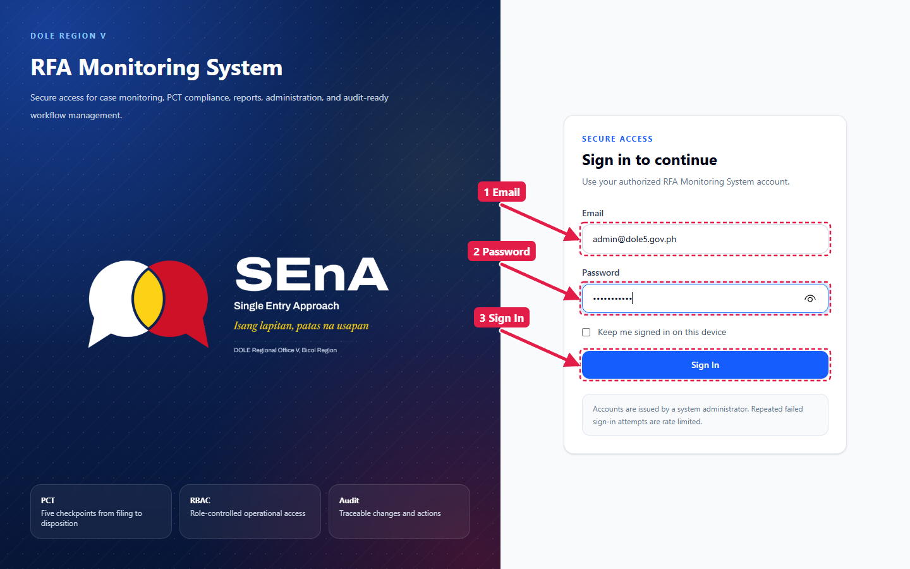

*Figure 1. Sign-in page*

> **Note:** A new account, or one whose password was reset by the Administrator, is taken straight to **My Account** to set a new password. After five failed attempts, wait one minute before trying again.

## 2. Importing the CSV file (Administrator)

Only the Administrator sees **CSV Import**. The imported records are visible to every user who can view RFAs.

### 2.1 Open CSV Import

After signing in you land on the Dashboard. The main menu is on the left. Click **CSV Import**.

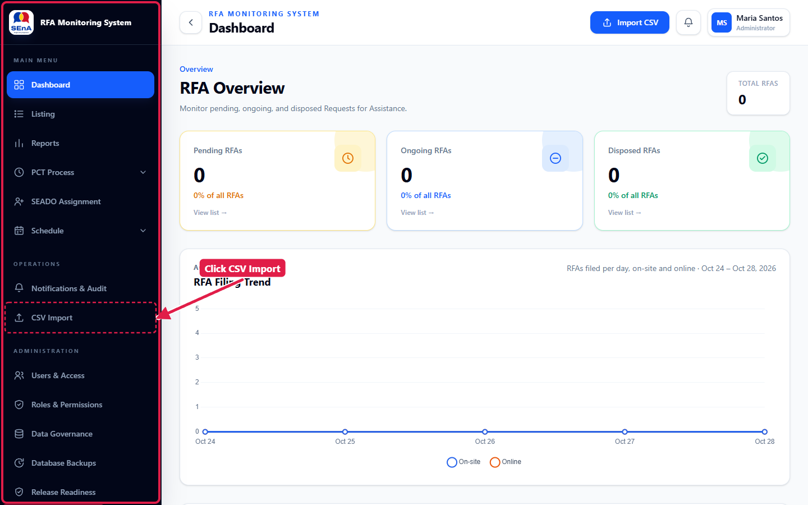

*Figure 2. Dashboard before any import — click CSV Import in the left menu*

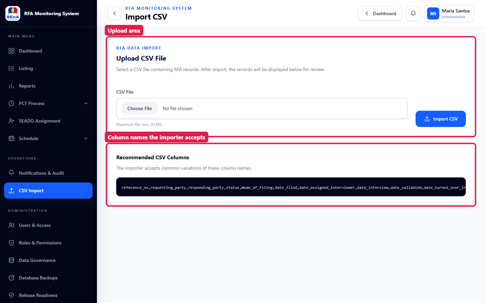

*Figure 3. The Import CSV page: the upload area and the column names the importer accepts*

### 2.2 Prepare the file

Save the spreadsheet as **CSV (comma delimited)**. The first row must hold the column names. Columns the importer recognises include:

| Information | Column name(s) |
| --- | --- |
| Office, docket | office, docket_no |
| Parties | requesting_party, responding_party, company_address, industry |
| Filing | mode_of_filing (Onsite / Online), date_filed, date_ta_nores |
| Interviewer stage | interviewer, date_assigned_interviewer, date_interview, date_validated, date_turned_over_lr |
| SEADO stage | seado, date_assigned_seado, date_initial_conference, date_both_parties_appeared |
| Closure | disposition_status, mode, date_disposed, monetary_benefit, workers_benefited |
| Status from the source sheet | case_status |

Dates may be written as `2026-10-19`, `10/19/2026` or `Oct 19, 2026`.

### 2.3 Upload

1. Click **Choose File** and select the CSV file (maximum 20 MB).
2. Click **Import CSV**.

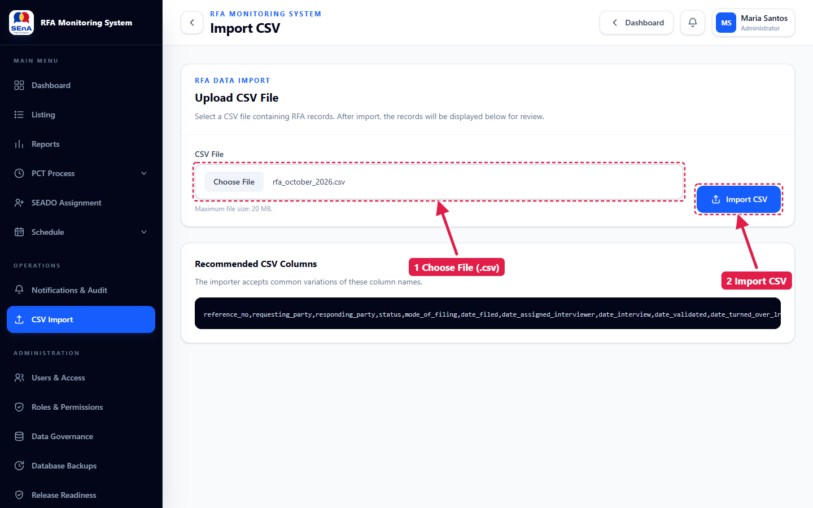

*Figure 4. Choose the file, then click Import CSV*

### 2.4 Check the result

A green message summarises the import: rows processed, records created, records updated and duplicate rows skipped. The **Imported Records** table below lists the records in this batch.

- Importing the same file again **updates** the existing records — it does not duplicate them.
- Identical rows inside one file are imported once and counted as "duplicate row(s) skipped".
- If anything goes wrong, **nothing** is saved and a red message explains why. Fix the file and import again.
- For an **on-site** filing, the system sets the interviewer assignment and interview dates to the filing date (on-site complainants are interviewed the same day).

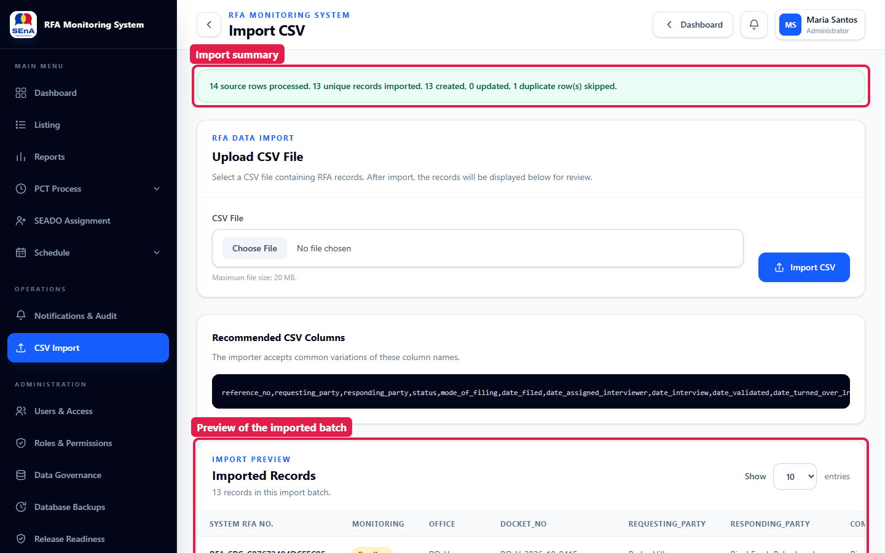

*Figure 5. Import summary message and the preview of the batch*

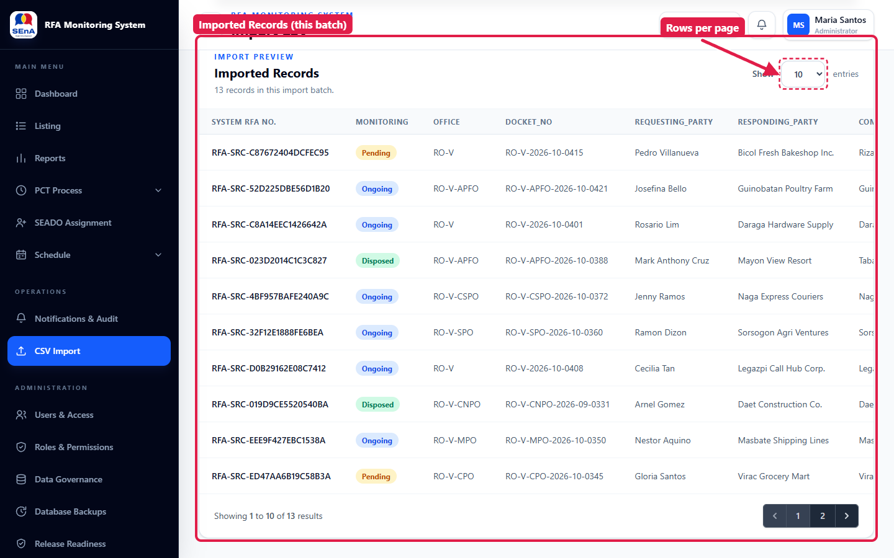

*Figure 6. Imported Records — use Show … entries to change the rows per page*

## 3. Reviewing the records

### 3.1 Dashboard

Click **Dashboard** in the left menu. The three status cards count Pending, Ongoing and Disposed RFAs; click a card to open the Listing filtered to that group. The **RFA Filing Trend** chart shows on-site and online filings over the last five days.

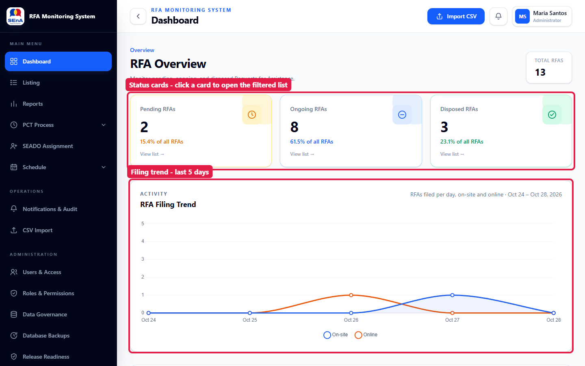

*Figure 7. Dashboard after the import*

### 3.2 RFA Listing

Click **Listing** in the left menu to see every record. Use **Search & Filters** to narrow the list by office, SEADO, monitoring group, workflow status, mode of filing, disposition or filing date, then click **Apply Filters**.

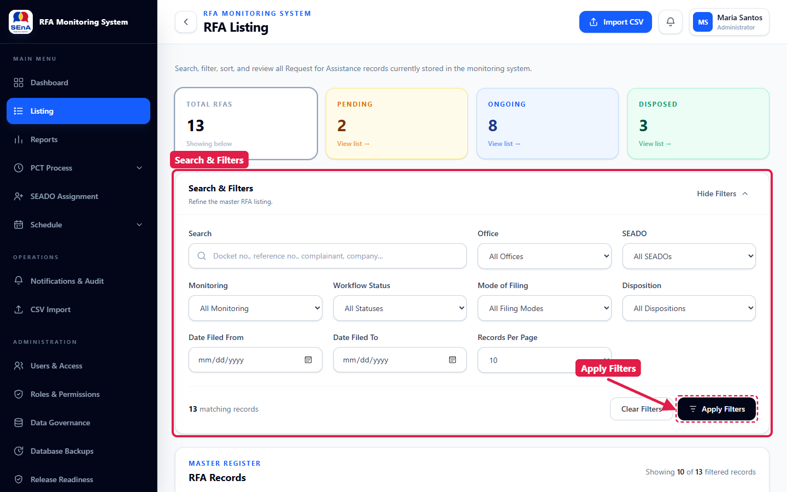

*Figure 8. RFA Listing with the Search & Filters panel*

### 3.3 Open a case

1. Type the docket number, reference number, complainant or company in **Search**, then click **Apply Filters**.
2. Click **Open** at the end of the row.

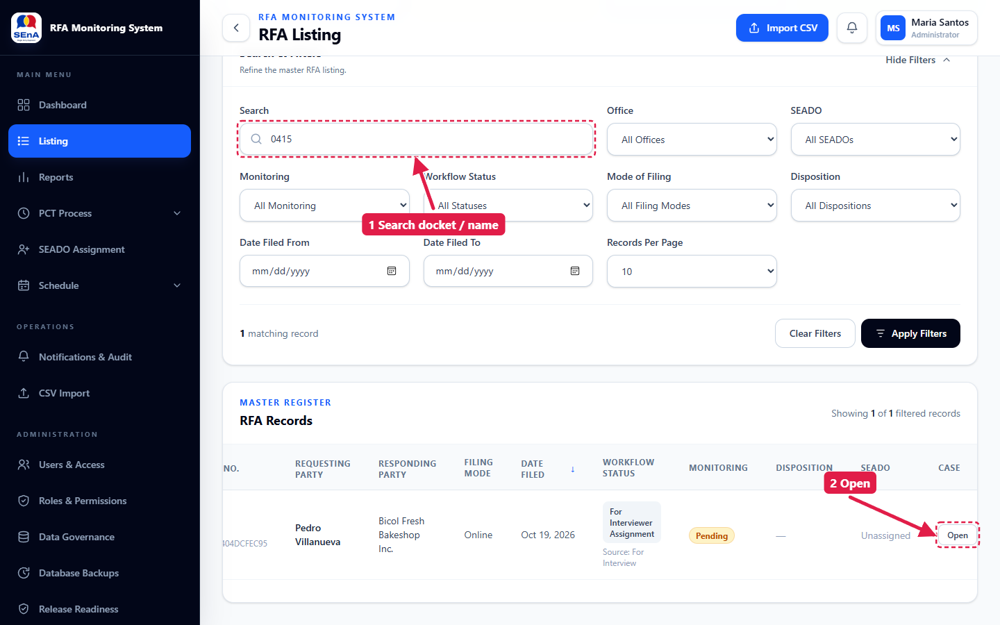

*Figure 9. Search for the case, then click Open*

## 4. Assigning the Interviewer

The case page shows the case header and the five PCT checkpoints at the top. Each section below it (Assignments, Workflow Progress, Conference, Disposition, Case Information) has its own **Save** button and saves on its own.

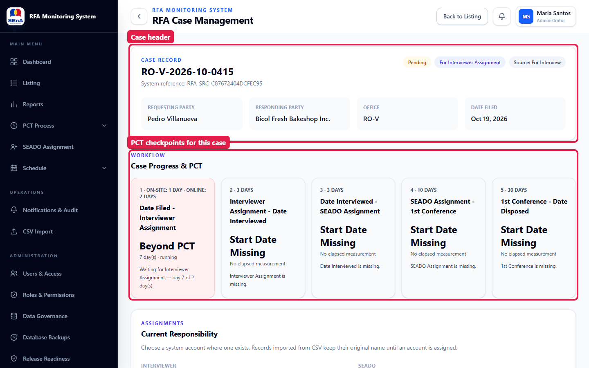

*Figure 10. Case header and the PCT checkpoints for this case*

Scroll to **Assignments** (Current Responsibility):

1. Under **Interviewer → System Account**, choose the Interviewer.
2. Enter the **Date Assigned to Interviewer**.
3. Click **Save Assignment**.

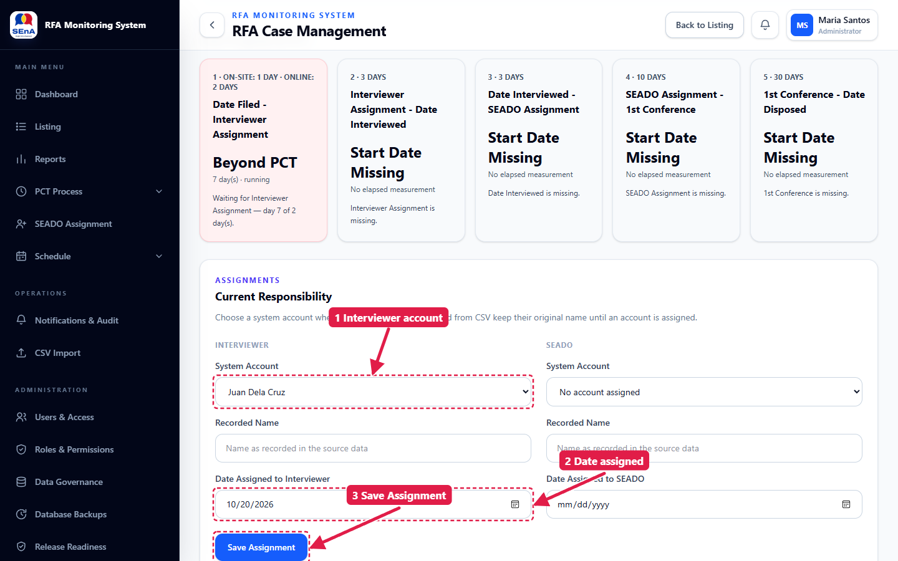

*Figure 11. Assign the Interviewer and save*

A green **Success — Assignment saved** message appears and checkpoint 1 is now completed. The Interviewer receives an in-app notification.

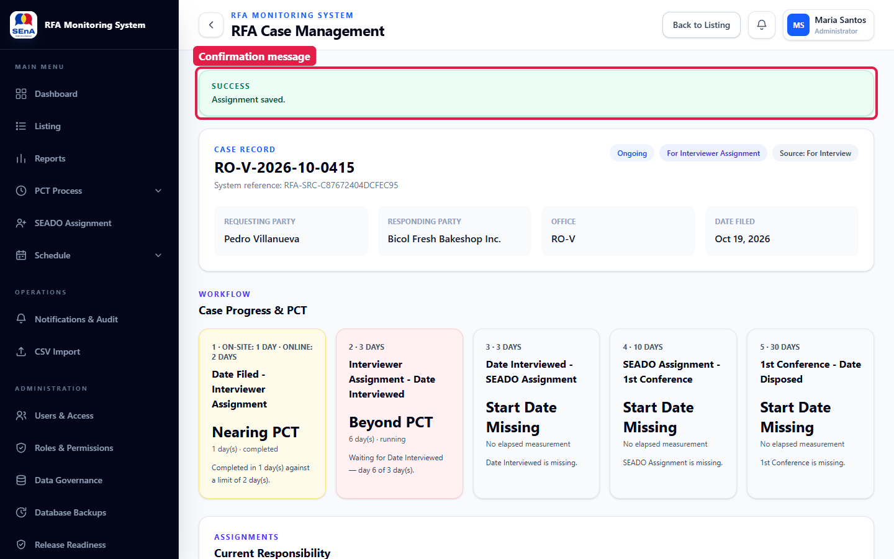

*Figure 12. Assignment saved; the PCT checkpoints update immediately*

> **Note:** Choose a **System Account** whenever the person has one — that is what sends them notifications. **Recorded Name** keeps the name exactly as it came from the CSV.

## 5. Recording the interview (Interviewer)

### 5.1 Open the assignment from the notification bell

Sign in with your Interviewer account. A red dot on the **bell** (top right) means you have new alerts.

1. Click the **bell**.
2. Click the alert ("Assigned as Interviewer — …") to open the case.

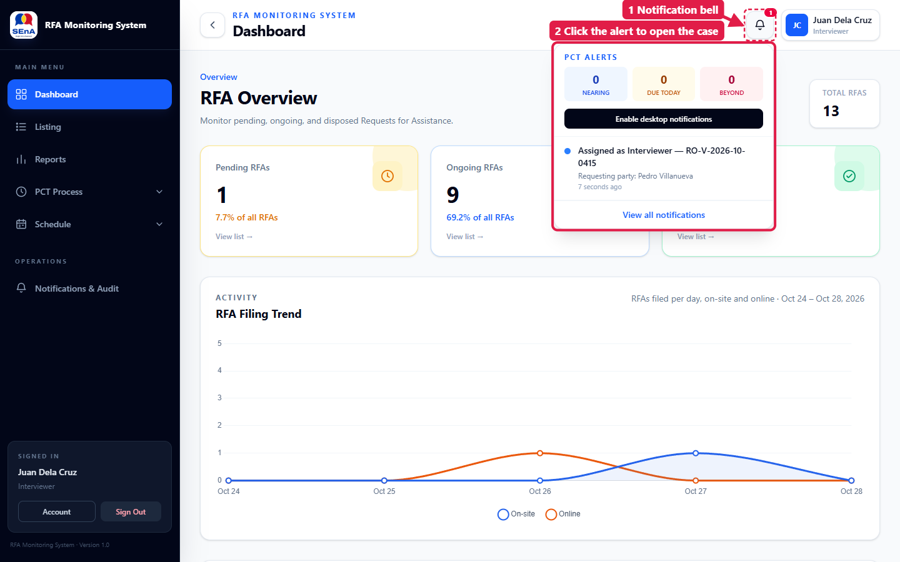

*Figure 13. The notification bell lists your new assignment*

### 5.2 Workflow Progress

Scroll to **Workflow Progress**:

1. Set the **Workflow Status** (for example, *For SEADO Assignment* once the case is turned over).
2. Enter the dates as they happen: **Date TA/NORES**, **Date Interviewed**, **Date Validated** and **Date Turned Over to LR**.
3. Click **Save Workflow Progress**.

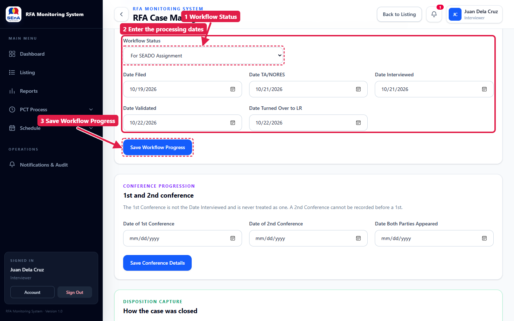

*Figure 14. Enter the processing dates and save*

> **Note:** The system refuses dates that are out of order (for example, an interview before the assignment) or in the future, and the message names both dates. Correct the date and save again.

### 5.3 Case Timeline

Every save is recorded in the **Case Timeline** at the bottom of the case page — who changed what, and the old and new values. Use **Add a note** for anything the form does not capture.

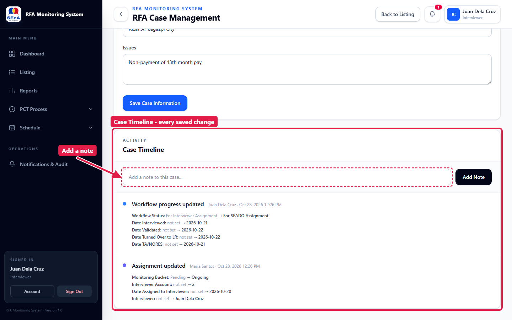

*Figure 15. Case Timeline and the Add a note box*

## 6. Assigning the SEADO

Users who can assign cases (Administrator, or a role with assignment rights) click **SEADO Assignment** in the left menu.

### 6.1 (Optional) Random draw

The **Random SEADO Draw** picks one SEADO at random from those who have handled the fewest RFAs. SEADOs on leave can be added to **Excluded from the draw**. The draw is a suggestion only — it does not assign anything.

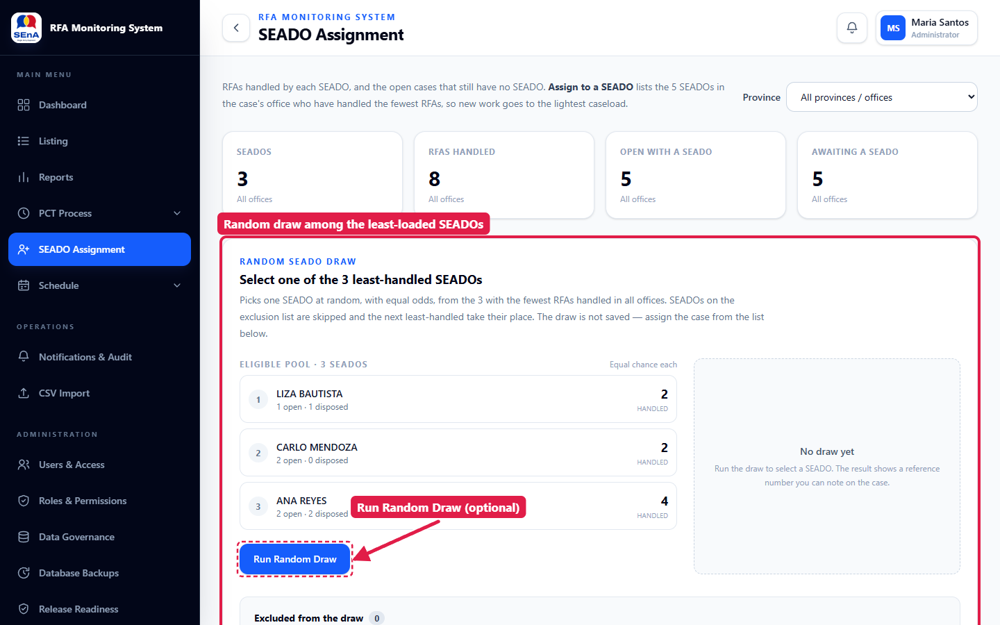

*Figure 16. SEADO Assignment page and the random draw*

### 6.2 Assign the case

Scroll to **Open RFAs awaiting a SEADO** and click **Assign to a SEADO** on the case row.

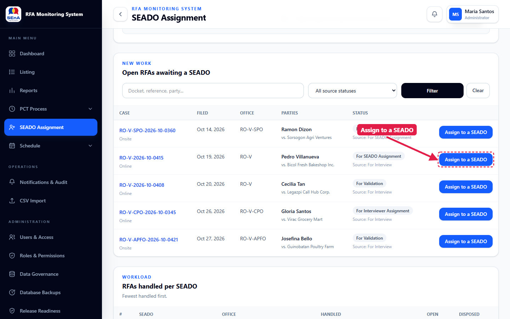

*Figure 17. Click Assign to a SEADO on the case*

1. Choose the **SEADO** (the list shows the SEADOs with the lightest caseload in that office).
2. Enter the **Date assigned**.
3. Click **Assign**.

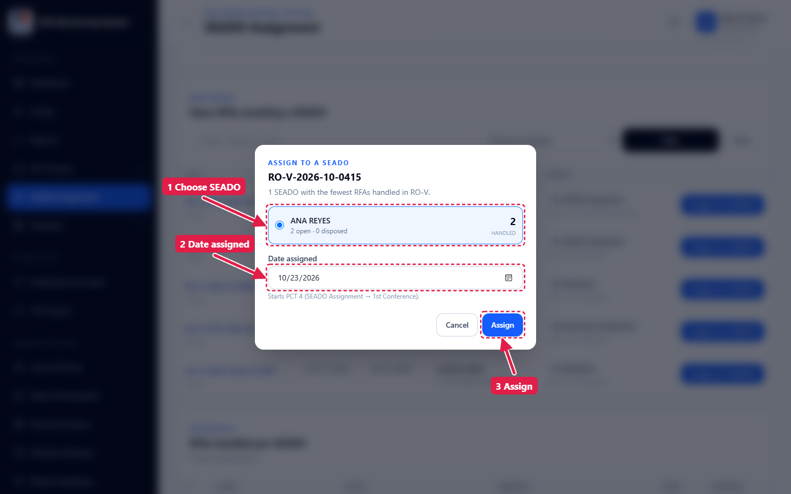

*Figure 18. Choose the SEADO and the date, then click Assign*

A green message confirms the assignment and the case leaves the waiting list. The SEADO receives a notification.

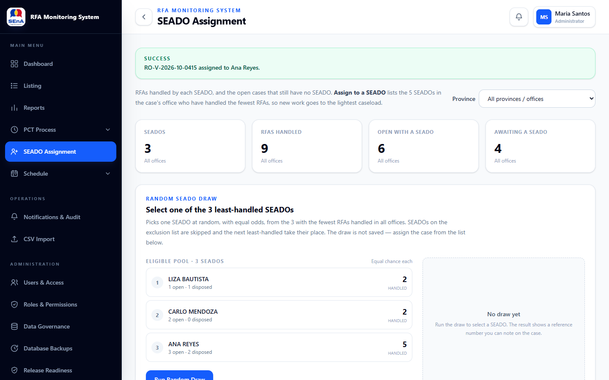

*Figure 19. Assignment confirmed*

> **Note:** A SEADO can also be assigned or changed from the case page, in the **Assignments** section (Section 4).

## 7. SEADO: completing missing intake dates

When a SEADO signs in and one of their cases is missing the **Date Interviewed** or **Date TA/NORES**, a reminder appears at the bottom right of the screen.

- Click the case in the reminder to fix it now, or
- click the **×** to be reminded at your next sign-in.

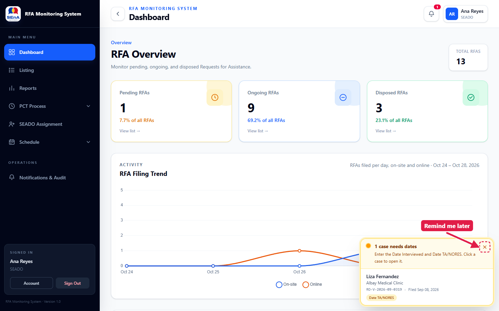

*Figure 20. Reminder: a case needs its intake dates*

Opening such a case shows a required form. Enter the missing dates and click **Save Dates**. The case page opens after the dates are saved.

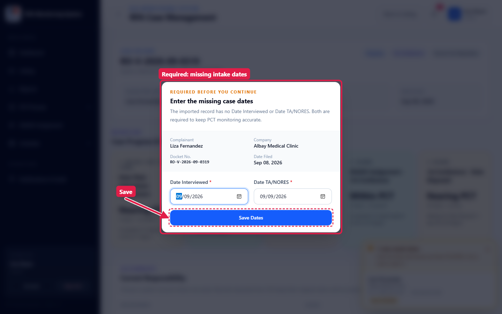

*Figure 21. Required form for the missing intake dates*

New assignments arrive in the **bell**, the same way as for Interviewers. Click the alert to open the case.

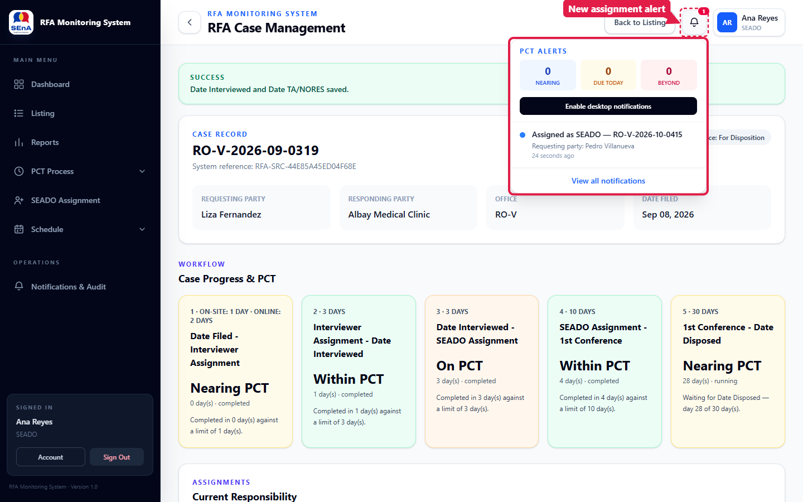

*Figure 22. The SEADO's new assignment alert*

## 8. SEADO: recording the conference

On the case page, scroll to **Conference Progression**:

1. Enter the **Date of 1st Conference**. Add **Date of 2nd Conference** and **Date Both Parties Appeared** when they apply.
2. Click **Save Conference Details**.

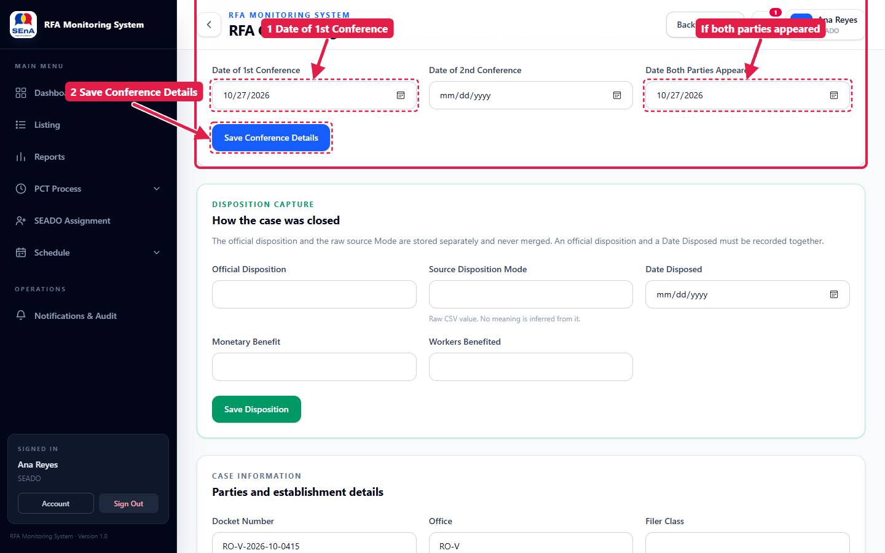

*Figure 23. Conference Progression*

> **Note:** A 2nd conference cannot be saved without a 1st. The 1st conference is not the interview date.

### My Conference Schedule

Click **Schedule → My Conference Schedule** in the left menu to see your conferences for the week. Use **Previous**, **Next** or the date box to move between weeks, and **Open case** to jump to a case.

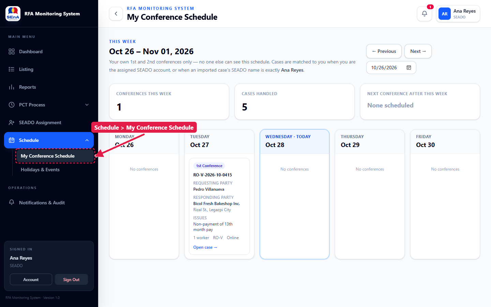

*Figure 24. My Conference Schedule*

## 9. SEADO: recording the disposition

On the case page, scroll to **Disposition Capture**:

1. Enter the **Official Disposition** (for example, *Settled*).
2. Enter the **Date Disposed**. Add **Monetary Benefit** and **Workers Benefited** if any.
3. Click **Save Disposition**.

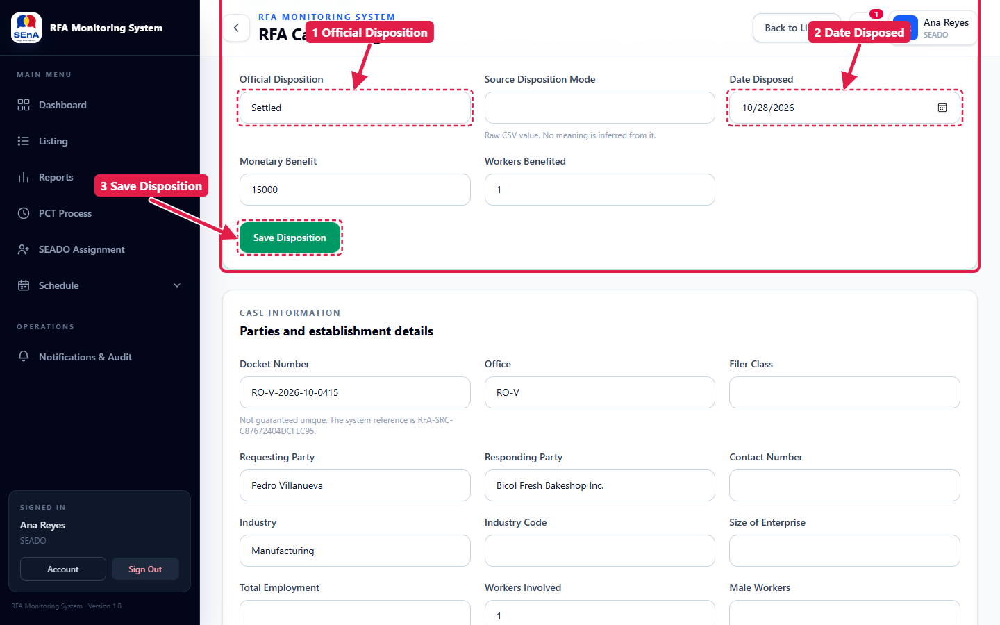

*Figure 25. Disposition Capture*

The case is now **Disposed** and all five PCT checkpoints show their final rating.

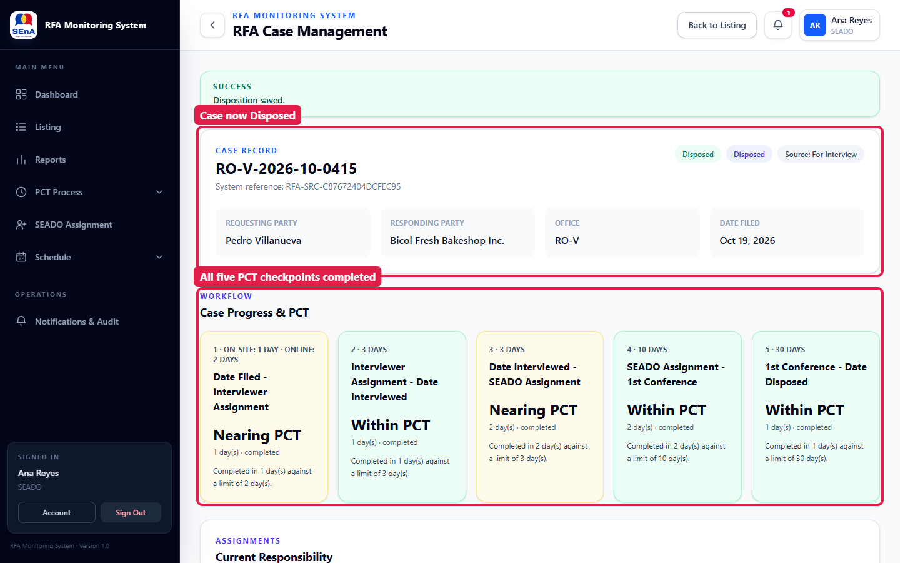

*Figure 26. The disposed case*

- The Official Disposition and the Date Disposed must be entered **together**; one without the other is refused.
- **Source Disposition Mode** keeps the raw "Mode" value from the CSV. It is never treated as the official disposition.
- To correct a closed case, use **Reopen Case** in the same section and give a reason. The previous disposition stays visible in the Case Timeline.

## 10. Monitoring deadlines (PCT)

### 10.1 Notifications & Audit

Click **Notifications & Audit** in the left menu. The cards count your unread, due-today, overdue and assignment alerts. Click **Run PCT Scan** to check every open case against its deadlines now (the scan also runs automatically every day at 7:00 AM when the scheduler is set up).

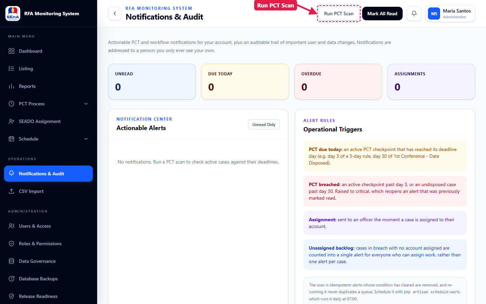

*Figure 27. Run PCT Scan*

Your alerts appear under **Actionable Alerts**. Use **Open case**, **Mark read** or **Dismiss** on each one, or **Mark All Read** at the top.

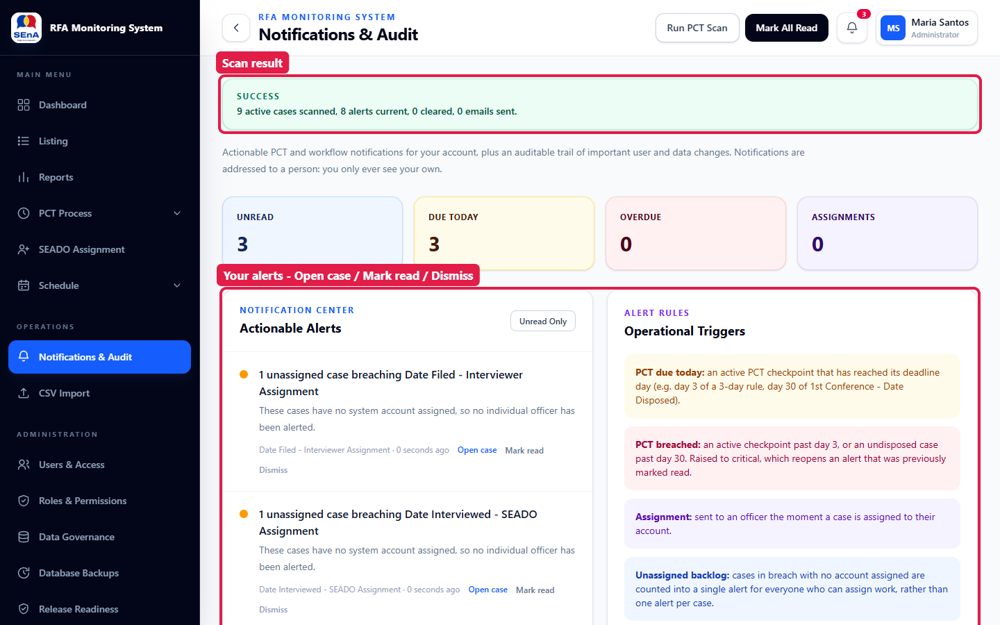

*Figure 28. Scan result and your alerts*

### 10.2 PCT Monitoring

Click **PCT Process → PCT Monitoring**. The summary cards count the running timers by rating; click a card to filter the table. Use **Office**, **Checkpoint**, **PCT Status** and **Search** to narrow it further. Cases most at risk are listed first.

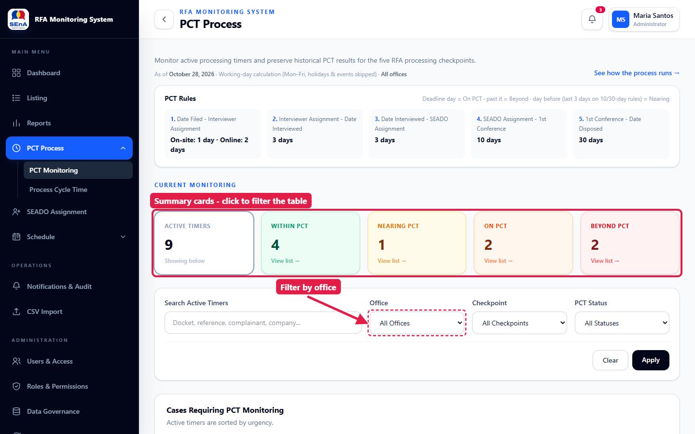

*Figure 29. PCT Monitoring*

### 10.3 Process Cycle Time

Click **PCT Process → Process Cycle Time** for one card per checkpoint (where the clock starts and stops, running and late counts, average days and on-time rate) and a timeline for each case.

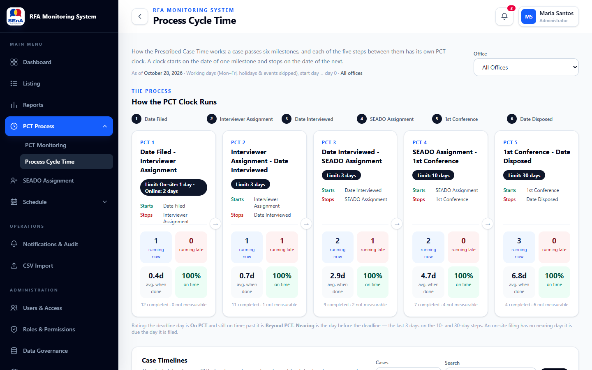

*Figure 30. Process Cycle Time*

## 11. Reports

Click **Reports** in the left menu.

1. Set the filters (search, filing dates, office, SEADO, conference level, status, disposition) and click **Generate Report**. The summary, PCT compliance, breakdowns and record table update.
2. Click **Export CSV** to download the filtered records as a spreadsheet, or **Print Report** to open the printable report.

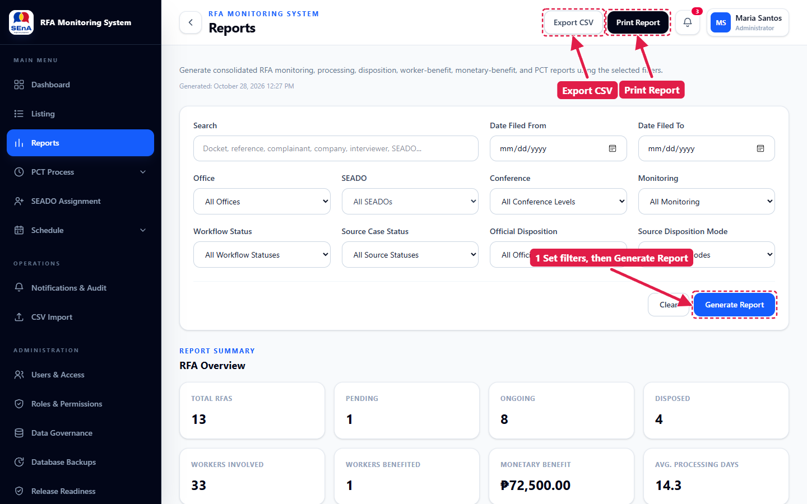

*Figure 31. Reports: filters, Export CSV and Print Report*

The print report is laid out for **13 × 8 inch landscape** (long bond / folio) paper and includes every matching record. Click **Print Report** at the top right of that page, choose the paper size, or save it as PDF.

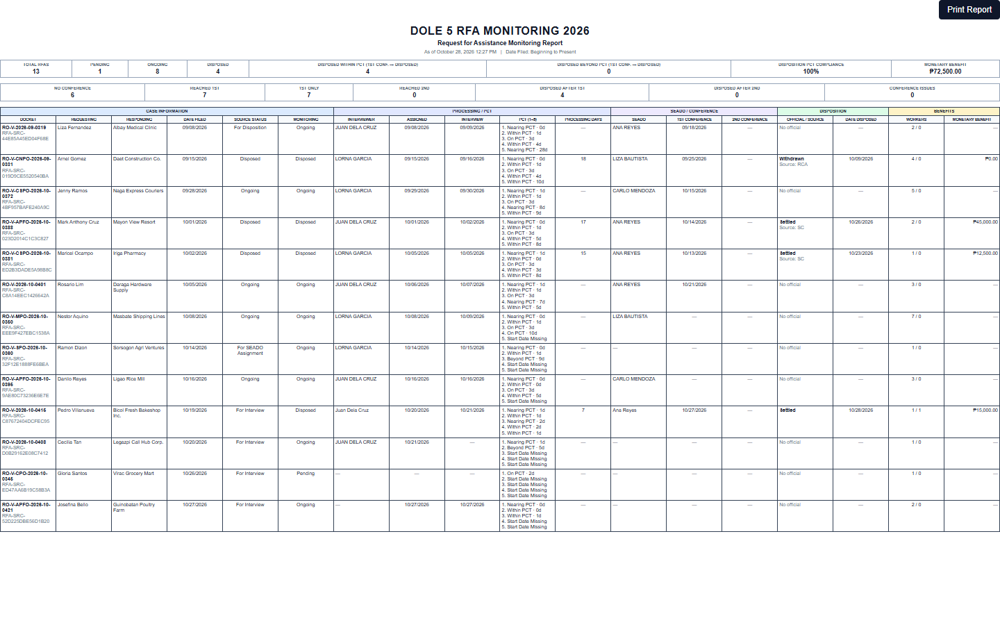

*Figure 32. Printable report*

## 12. My Account and signing out

Click your name at the top right:

- **My Account** — update your details or change your password.
- **Sign Out** — end your session. You can also use **Sign Out** at the bottom of the left menu.

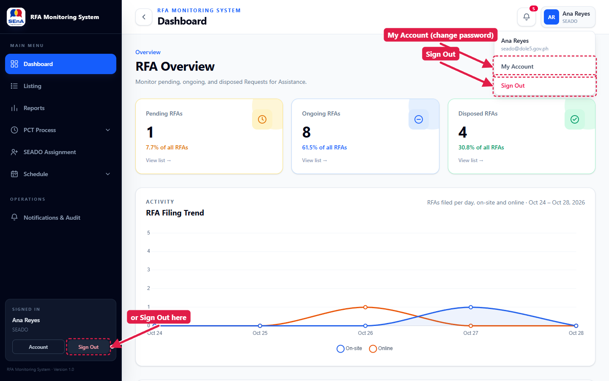

*Figure 33. My Account and Sign Out*

> **Note:** Always sign out on a shared computer.

## Troubleshooting

| What you see | What to do |
| --- | --- |
| "The CSV contains duplicate column names." | Two columns have the same name. Rename or remove one, save as CSV and import again. |
| "The CSV import failed. No records were saved." | Nothing was imported. Check the dates and that the file is a real CSV, then import again. |
| A date is refused when saving | The message names the conflicting dates. Dates must follow the case order and cannot be in the future. |
| A menu item or button is missing | Your role does not include it. Ask the Administrator. |
| Checkpoint 1 shows "Mode of Filing Missing" | Open the case and set the mode of filing so the deadline can be computed. |
| You are signed out unexpectedly | The account may have been deactivated. Contact the Administrator. |
